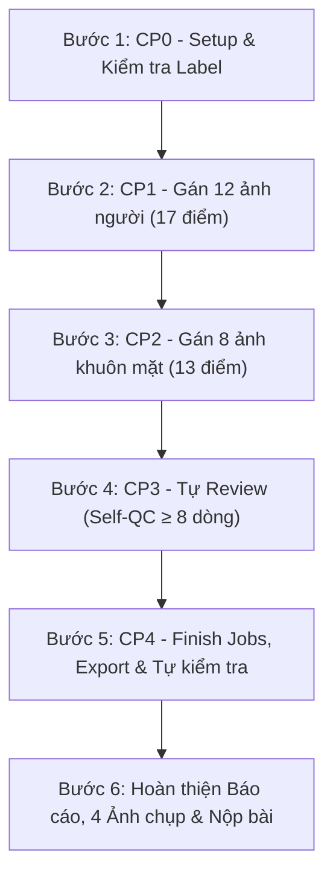

# Hướng dẫn thực hành Lab Ngày 4 — Gán Keypoint & Pose

Tài liệu này tổng hợp toàn bộ quy trình thực hành từ các tài liệu gốc ([`README.md`](README.md), [`CHECKPOINTS.md`](CHECKPOINTS.md), [`RULES.md`](RULES.md), [`RUBRIC.md`](RUBRIC.md), [`SUBMISSION.md`](SUBMISSION.md)) thành một lộ trình từng bước rõ ràng, liền mạch để hoàn thành bài lab và nộp bài đạt điểm tối đa.

---

## 0. Thông tin nhanh & Phân bổ thời gian (240 phút)

- **Loại bài:** Cá nhân. Mỗi học viên có bộ ảnh riêng theo MSSV, làm trên CVAT local (Docker).
- **Học viên:** Phạm Văn Ngọc Vinh (`PhamVanNgocVinh`) — MSSV: `03262` (Mã HV: `2A202603262`).
- **File báo cáo cá nhân:** [`report/individual/03262_PhamVanNgocVinh.md`](report/individual/03262_PhamVanNgocVinh.md).
- **Hạn nộp:** **23:59 GMT+7 ngày làm lab** (nộp link repo trên LMS). Nộp muộn: −10%/ngày (quá 3 ngày không nhận).

| Mốc phút | Thời lượng | Nội dung | Checkpoint | Sản phẩm phải có |
|---|---:|---|---|---|
| 0–5 | 5′ | Chữa exit ticket buổi sáng | | Đã chuẩn bị môi trường |
| 5–45 | 40′ | Kiểm tra CVAT, chạy setup, kiểm tra label schema | **CP0** | `src/exports/assignment.json`, điền mục 0 & 1 báo cáo |
| 45–105 | 60′ | Gán 10 ảnh người: `easy` (5), `occluded` (3), `back` (2) | **CP1** | Xong ít nhất 8 ảnh người ở phút 105 |
| 105–120 | 15′ | Nghỉ giải lao (`Ctrl+S` lưu bài trước khi nghỉ) | | |
| 120–150 | 30′ | Gán 2 ảnh người còn lại: `small` (1), `crowd` (1) | **CP1** | Hoàn thành đủ 12 ảnh người |
| 150–180 | 30′ | Gán 8 ảnh khuôn mặt (13 điểm) | **CP2** | Hoàn thành 8 skeleton mặt, điền mục 2 & 3 báo cáo |
| 180–200 | 20′ | Tự review nhãn (self-QC) với 5 ảnh người + 3 ảnh mặt | **CP3** | Bảng review ≥ 8 dòng ở mục 4 báo cáo |
| 200–210 | 10′ | Xuất COCO Keypoints, chạy script tự kiểm | **CP4** | 2 file zip trong `src/exports/`, script báo ĐẠT |
| 210–240 | 30′ | Chụp 4 ảnh minh họa, hoàn thiện báo cáo, làm bonus | **Bonus** | Đủ 4 ảnh ở `report/individual/images/`, hoàn thành mục 5–9 |

---

## 1. Ba quy tắc cốt lõi & Quy ước cờ Visibility

### 1.1. Ba quy tắc sống còn
1. **Trái/phải tính theo chính người trong ảnh:**
   - Người quay mặt về camera: tay trái của họ nằm ở **bên phải ảnh**.
   - Người quay lưng về camera: tay trái của họ nằm ở **bên trái ảnh**.
   - Người nghiêng nhìn sang phải ảnh: bên gần camera là **bên phải** của họ; bên xa camera là bên trái.
   - *Quy tắc:* Luôn tự nói ra hướng người trước khi kéo điểm. Tuyệt đối tránh lỗi `lr_swap` (đổi trái/phải sẽ bị trừ 3 điểm/người).
2. **Không đoán bừa:**
   - `v = 2` (nhìn thấy khớp rõ ràng): hiển thị bình thường.
   - `v = 1` (khớp bị che khuất nhưng ước lượng chắc chắn vị trí): đặt cờ `occluded` (vòng tròn rỗng).
   - `v = 0` (ngoài khung hình hoặc không thể đoán chắc): đặt cờ `outside` (biến mất khỏi ảnh). Tuyệt đối **không kéo điểm ngoài ảnh về mép ảnh**.
3. **Chỉ gán người thật trong cảnh có chiều cao ≥ 60 px:**
   - Không gán người trên poster, tranh ảnh, trong gương, màn hình tivi/điện thoại, tượng.
   - Người cao dưới 60 px: không gán skeleton, chỉ đếm số lượng vào báo cáo.

### 1.2. Phím tắt thao tác nhanh trên CVAT
- `N`: Bắt đầu / Kết thúc vẽ skeleton.
- `Q` (khi rê chuột vào điểm): Bật/tắt cờ `occluded` (`v = 1`).
- `O` (khi rê chuột vào điểm): Bật/tắt cờ `outside` (`v = 0`).
- `L`: Khóa/mở khóa shape (tránh kéo nhầm skeleton đã xong).
- `Ctrl+S`: Lưu bài (bắt buộc bấm thường xuyên sau mỗi đối tượng).
- Chuột phải vào điểm: Mở menu 4 nút (outside · khóa · occluded · hidden). **Không dùng phím H (hidden)** vì chỉ ẩn tạm thời, khi xuất vẫn ra `v = 2`.

---

## 2. Lộ trình thực hiện từng bước chi tiết



---

### Bước 1: Khởi động & Setup Project trên CVAT (CP0 — 40 phút)

1. **Khởi động Docker:** Mở Docker Desktop và đợi Docker Engine sẵn sàng.
2. **Kiểm tra và sửa lỗi CVAT:**
   ```bash
   python lab.py check
   ```
   *(Lệnh sẽ kiểm tra các container CVAT, OPA, sửa lỗi kẹt "Connecting..." của Nuclio nếu có).*
3. **Khởi tạo bài lab cá nhân:**
   ```bash
   python lab.py setup --mssv 03262 --ten PhamVanNgocVinh
   ```
   *(Nếu muốn làm bonus B1/B2, thêm cờ `--bonus`). Lệnh sẽ tải ảnh theo MSSV, tạo project `d04-keypoint`, 2 task `persons-PhamVanNgocVinh` và `faces-PhamVanNgocVinh`, đồng thời sinh file `src/exports/assignment.json`.*
4. **Kiểm tra Label trong CVAT:**
   - Vào CVAT → **Projects** → `d04-keypoint` → tab **Labels**.
   - Kiểm tra label `person` (kiểu Skeleton): Đúng 17 điểm, 19 cạnh, mẫu dựng theo người quay mặt về camera (`left_*` ở bên phải khung).
   - Kiểm tra label `face` (kiểu Skeleton): Đúng 13 điểm, 13 cạnh.
5. **Cập nhật Báo cáo:** Kiểm tra và hoàn thiện mục `0. Thông tin học viên` và `1. Kiểm tra label (CP0)` trong [`report/individual/03262_PhamVanNgocVinh.md`](report/individual/03262_PhamVanNgocVinh.md).

---

### Bước 2: Gán nhãn 12 ảnh người — 17 điểm COCO (CP1 — 90 phút)

Mở job `persons-PhamVanNgocVinh` (đường dẫn in ra từ lệnh setup). Thực hiện lần lượt 12 ảnh:

1. **Quy trình gán từng người:**
   - Bấm `N` hoặc chọn biểu tượng **Draw new skeleton** bên trái → chọn label `person` → bấm **Shape** (không dùng Track).
   - Kéo khung bao quanh người. CVAT sẽ đặt sẵn 17 điểm theo mẫu.
   - **Xác định hướng người:**
     - Nếu người **quay lưng**: Kéo toàn bộ cụm điểm `left_*` sang bên trái ảnh trước rồi mới căn chỉnh.
   - Kéo từng điểm vào tâm khớp theo thứ tự: Đầu (`nose`, `left_eye`, `right_eye`, `left_ear`, `right_ear`) → Vai (`left_shoulder`, `right_shoulder`) → Khuỷu tay & Cổ tay → Hông (`left_hip`, `right_hip`: đặt vào khớp háng, không đặt cạp quần) → Đầu gối → Cổ chân.
   - **Gán cờ visibility:**
     - Khớp bị che nhưng ước lượng chắc chắn vị trí (ví dụ chân bị xe che một phần, tay đặt sau lưng): Rê chuột vào điểm, bấm `Q` (`v = 1`).
     - Khớp ngoài khung hình hoặc hoàn toàn không đoán được: Rê chuột vào điểm, bấm `O` (`v = 2`).
   - Kiểm tra đường nối xương: Hai chân/tay có bị bắt chéo bất thường không (dấu hiệu đảo trái/phải).
   - Bấm `Ctrl+S` lưu lại sau mỗi người.
2. **Tiến độ cần đạt:**
   - **Mốc phút 105:** Hoàn thành ít nhất 8/10 ảnh đầu tiên (`easy`, `occluded`, `back`).
   - **Mốc phút 150:** Hoàn thành đủ 12 ảnh (bao gồm `small` và `crowd`).
3. **Cập nhật báo cáo:** Ghi lại số skeleton đã gán, số người < 60 px bỏ qua vào **Mục 2**, và ghi lại các ca phân vân giữa `v = 1` và `v = 0` vào **Mục 3 (Bảng ca khó)**.

---

### Bước 3: Gán nhãn 8 ảnh khuôn mặt — 13 điểm (CP2 — 30 phút)

Mở job `faces-PhamVanNgocVinh`:

1. **Quy trình gán từng mặt:**
   - Chọn Skeleton → label `face` → **Shape** → Kéo khung bao mặt.
   - **Xác định trái/phải:** Mắt và khóe miệng bên phải ảnh là `left_eye_*` và `mouth_left`.
   - Phóng to ảnh để đặt mí mắt chính xác:
     - `left_eye_outer` / `right_eye_outer`: Khóe mắt ngoài.
     - `left_eye_inner` / `right_eye_inner`: Khóe mắt trong (gần sống mũi).
     - `left_eye_upper` / `right_eye_upper`: Giữa mí trên, ngay trên tâm con ngươi.
     - `left_eye_lower` / `right_eye_lower`: Giữa mí dưới, ngay dưới tâm con ngươi.
     - `nose_tip`: Chóp mũi.
     - `mouth_left` / `mouth_right`: Hai khóe miệng (góc tiếp xúc môi trên và dưới).
     - `lip_upper` / `lip_lower`: Giữa mép ngoài môi trên / môi dưới.
   - **Xử lý ca khó:**
     - Kính râm tối: Đặt 4 điểm mắt theo ước lượng gọng kính và bấm `Q` (`occluded`, `v = 1`). Kính trong giữ nguyên `v = 2`.
     - Mặt nghiêng: Điểm bị che khuất sau sống mũi bấm `Q` (`v = 1`) hoặc `O` (`v = 0` nếu hoàn toàn không đoán được).
   - Bấm `Ctrl+S`.
2. **Cập nhật báo cáo:** Điền dòng `faces` ở **Mục 2** và các ca phân vân vào **Mục 3**.

---

### Bước 4: Tự Review nhãn — Self-QC (CP3 — 20 phút)

Duyệt ngược từ ảnh cuối về ảnh đầu bằng góc nhìn khắt khe để tìm lỗi:

1. **Phạm vi kiểm tra:** Chọn ít nhất **5 ảnh người** (ưu tiên ảnh quay lưng `back` hoặc đám đông `crowd`) và **3 ảnh khuôn mặt**.
2. **Kiểm tra 5 mã lỗi chuẩn:**
   - `lr_swap`: Đổi trái/phải (lỗi nặng nhất, kiểm tra kỹ hướng người và các đường xương bắt chéo).
   - `vis_flag`: Sai cờ visibility (thấy rõ mà để v=1, hoặc che khuất/ngoài ảnh mà để v=2).
   - `position`: Lệch vị trí tâm khớp / mí mắt.
   - `missing`: Bỏ sót người thật cao ≥ 60 px.
   - `extra`: Gán nhầm poster, tượng, ảnh in, người < 60 px hoặc trùng skeleton.
   - `ok`: Ảnh hoàn toàn chuẩn xác không có lỗi.
3. **Thực hiện sửa lỗi:** Sửa ngay trên CVAT, bấm `Ctrl+S`.
4. **Cập nhật báo cáo:** Điền đầy đủ vào **Mục 4. Bảng tự review** (tối thiểu 8 dòng, ghi rõ lỗi trước khi sửa và đánh dấu cột "Đã sửa?").

---

### Bước 5: Xuất dữ liệu, Chạy kiểm tra tự động & Chuyển Job (CP4 — 10 phút)

1. **Chuyển trạng thái Job trên CVAT:**
   - Trong giao diện từng job (`persons` và `faces`), vào **Menu** (góc trên bên trái) → bấm **Finish the job** để chuyển job sang trạng thái **completed** *(Bắt buộc theo rubric)*.
2. **Xuất file và tự kiểm tra tự động:**
   ```bash
   python lab.py export
   ```
   - Lệnh tự động tải 2 file COCO Keypoints 1.0 (không kèm ảnh) vào `src/exports/`:
     - `PhamVanNgocVinh_persons.zip`
     - `PhamVanNgocVinh_faces.zip`
   - Lệnh tự động kích hoạt `src/check_submission.py` để kiểm tra toàn diện cú pháp và tính hợp lệ.
3. **Đọc kết quả kiểm tra:**
   - Đạt yêu cầu khi dòng cuối báo: `Kết quả: ĐẠT` và không có bất kỳ dòng `[LỖI]` nào.
   - Nếu còn `[LỖI]`, mở CVAT sửa lại rồi chạy lại `python lab.py export`.
   - Copy toàn bộ phần **TÓM TẮT** từ terminal dán vào **Mục 5** của báo cáo cá nhân.
4. **Kiểm tra thủ công file JSON (CP4.5):**
   - Mở file zip, xem `annotations/person_keypoints_default.json`.
   - Chọn 2 người và 1 mặt để kiểm tra: mảng keypoints đủ 51 số (người) hoặc 39 số (mặt), `num_keypoints` khớp số điểm `v > 0`. Điền kết quả vào bảng ở Mục 5.

---

### Bước 6: Hoàn thiện Báo cáo & Nộp bài (Buffer — 30 phút)

1. **Chụp 4 ảnh minh họa và lưu vào `report/individual/images/`:**
   - `1_label_person.png`: Ảnh chụp cấu trúc label `person` trong Label constructor (đủ 17 điểm).
   - `2_nguoi_quay_lung.png`: Một người quay lưng đã gán đủ điểm, hiển thị rõ điểm `occluded` / `outside`.
   - `3_mat_phong_to.png`: Một khuôn mặt 13 điểm phóng to rõ vùng mắt và khóe mắt.
   - `4_json_export.png`: Ảnh chụp một đoạn JSON annotation xuất ra trong file zip (thấy `keypoints` và `num_keypoints`).
2. **Hoàn thành các mục còn lại trong báo cáo:**
   - Mục 6: Đảm bảo 4 ảnh hiển thị đúng đường dẫn.
   - Mục 7: Viết phần **Tự đánh giá** (lỗi gặp nhiều nhất, đề xuất rule, nhãn ảnh hưởng thế nào đến model heatmap/loss).
   - Mục 8: Ghi khó khăn / lỗi kỹ thuật (nếu có).
   - Mục 9: Ghi nhận công cụ AI đã sử dụng.
   - Phần Bonus (nếu có làm B1/B2/B3).
3. **Kiểm tra an toàn Git (Không commit ảnh gốc):**
   ```bash
   git ls-files | grep -iE "\.(jpg|jpeg|png|webp)$"
   ```
   *Lệnh chỉ được phép hiện ảnh trong `docs/images/`, `src/lab/images/` và 4 ảnh chụp của bạn trong `report/individual/images/`.*
4. **Commit & Push bài nộp:**
   ```bash
   git add -A
   git commit -m "Nop bai Lab Ngay 4 Keypoint Pose - PhamVanNgocVinh - 03262"
   git push -u origin main
   ```
5. **Nộp link repo trên LMS trước 23:59 GMT+7.**

---

## 3. Bảng tự rà soát trước khi nộp (Checklist)

- [ ] File báo cáo cá nhân đã đổi tên thành [`report/individual/03262_PhamVanNgocVinh.md`](report/individual/03262_PhamVanNgocVinh.md) và điền đủ tất cả mục 0–9.
- [ ] Thư mục `src/exports/` có đủ 3 file bắt buộc:
  - `assignment.json` (tạo bởi lệnh setup, không sửa tay).
  - `PhamVanNgocVinh_persons.zip` (định dạng COCO Keypoints 1.0, không kèm ảnh).
  - `PhamVanNgocVinh_faces.zip` (định dạng COCO Keypoints 1.0, không kèm ảnh).
- [ ] Chạy `python lab.py export` in ra `Kết quả: ĐẠT` (0 lỗi).
- [ ] Cả 2 job trên CVAT (`persons` và `faces`) đã chuyển sang trạng thái **completed**.
- [ ] Thư mục `report/individual/images/` có đủ 4 ảnh minh họa đúng tên quy định.
- [ ] Không commit thư mục `data/`, ảnh gốc bên ngoài, file `.env` hay mật khẩu.
- [ ] Đã push toàn bộ commit lên GitHub và nộp link repository trên hệ thống LMS.
