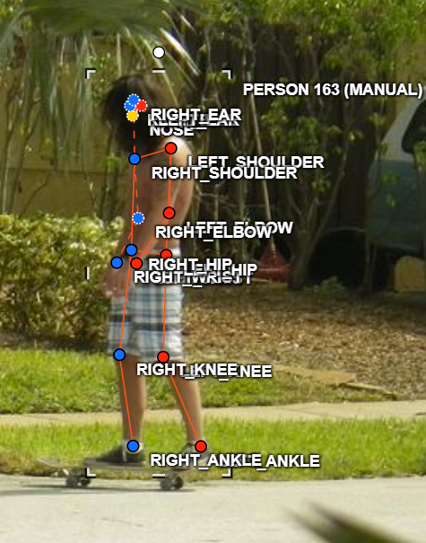
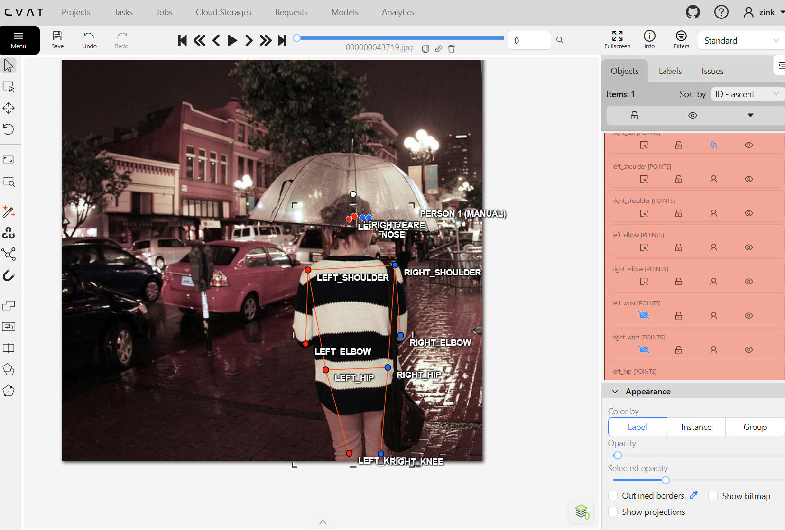
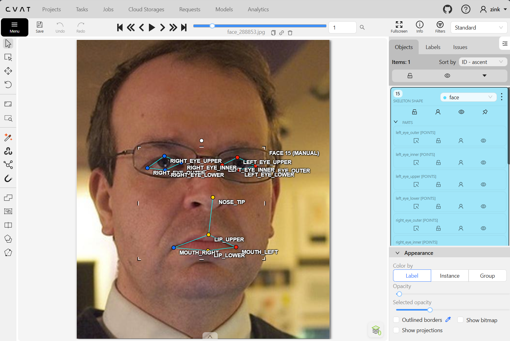
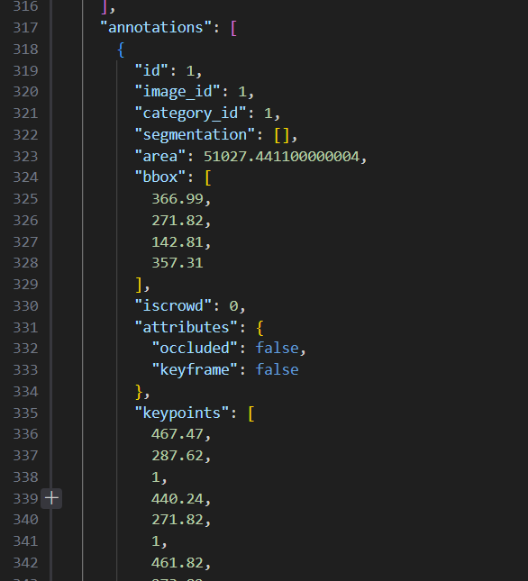

# Báo cáo cá nhân — PhamVanNgocVinh-03262

Đổi tên file theo quy tắc `MSSV_HoTen.md`. Ví dụ: `20241234_NguyenVanAn.md`.

Dữ liệu: 12 ảnh người COCO val2017 (Lin et al., 2014) và 8 ảnh chân dung Wikimedia Commons, chỉ dùng trong lớp.

## 0. Thông tin học viên

- Họ tên: Phạm Văn Ngọc Vinh
- MSSV: 03262 (Mã học viên: 2A202603262)
- Email: vinhphamvn02@gmail.com
- Link repository: https://github.com/o1676733391/K5-L2B-DAY03-PhamVanNgocVinh-03262-KeypointPose
- Phiên bản CVAT (Help → About): 2.82.1
- Máy: hệ điều hành Windows 11 · RAM 16 GB · chạy CVAT chế độ đầy đủ
- Bộ ảnh (`src/exports/assignment.json` do `lab.py setup` tạo): có
- Giờ bắt đầu: 08:30
- Giờ kết thúc: 11:15

## 1. Kiểm tra label (CP0)

| Label | Kiểu | Số điểm | Tên điểm đúng bảng của lab? | Đúng thứ tự? | Số cạnh |
|---|---|---:|---|---|---:|
| `person` | Skeleton | 17 | Có | Có | 19 |
| `face` | Skeleton | 13 | Có | Có | 13 |

Mẫu `person` dựng theo người quay mặt về camera (các điểm `left_*` nằm bên phải khung mẫu)? Có

Cách đổi cờ `occluded` / `outside` cho **một điểm** trên phiên bản CVAT này (một câu):

Rê chuột vào điểm cần đổi trên skeleton rồi bấm phím `Q` để đổi sang `occluded` (`v = 1`) hoặc phím `O` để đổi sang `outside` (`v = 0`), hoặc nhấp chuột phải vào điểm để chọn cờ tương ứng từ menu 4 nút.

## 2. Số lượng đã gán và thời gian (CP1, CP2)

| Nhóm ảnh | Số ảnh | Số skeleton đã gán | Số người dưới 60 px (không gán) | Số poster / gương / màn hình bỏ qua | Thời gian (phút) |
|---|---:|---:|---:|---:|---:|
| `easy` | 5 | 5 | 0 | 0 | 25 |
| `occluded` | 3 | 6 | 0 | 0 | 25 |
| `back` | 2 | 2 | 0 | 0 | 18 |
| `small` | 1 | 1 | 2 | 0 | 10 |
| `crowd` | 1 | 3 | 4 | 0 | 18 |
| `faces` | 8 | 8 | — | 0 | 25 |

- Số ảnh người đã xong ở mốc phút 105: 12 / 10
- Thời gian thực tế (phút): CP1 96 · CP2 25 · CP3 15
- Ảnh tốn thời gian nhất là ảnh nào, vì sao?

Ảnh `000000309169.jpg` (nhóm crowd) tốn nhiều thời gian nhất vì có nhiều người đứng san sát nhau, che khuất một phần thân thể của nhau. Cần phải phóng to để xác định ranh giới giữa người đứng trước và người đứng sau, phân biệt các khớp chân tay của từng người và lọc bỏ các đối tượng ở hậu cảnh có chiều cao dưới 60 px.

## 3. Bảng ca khó (CP1, CP2)

Mỗi điểm bạn phân vân một dòng, nhất là phân vân giữa `v = 1` và `v = 0`, hoặc không chắc hướng người.

| Ảnh | Người / mặt | Điểm | Cờ đã chọn | Phân vân giữa | Lý do chọn |
|---|---|---|---:|---|---|
| `000000043719.jpg` | Người #1 (quay lưng) | `left_wrist` | 1 | `v = 1` và `v = 0` | Cổ tay gập ra phía trước bụng, nhìn thấy hướng cẳng tay rõ ràng nên ước lượng chắc chắn được vị trí cổ tay. |
| `000000056651.jpg` | Người #1 (bị che) | `right_ankle` | 0 | `v = 1` và `v = 0` | Bị vật cản che khuất hoàn toàn từ đùi xuống dưới, không thể suy đoán vị trí bàn chân chắc chắn nên chọn outside. |
| `face_99874.jpg` | Mặt #1 (kính râm) | `left_eye_upper` | 1 | `v = 1` và `v = 2` | Tròng kính râm tối màu che khuất mí mắt nhưng vẫn ước lượng được vị trí chính xác của mắt theo gọng kính và tỷ lệ khuôn mặt. |
| `000000508269.jpg` | Người #1 (chân chéo) | `left_ankle` | 2 | `v = 2` và `lr_swap` | Người đang đứng vắt chéo chân, cổ chân trái vắt qua bên phải ảnh nhưng kiểm tra liên kết giải phẫu từ hông -> gối -> cổ chân vẫn đi đúng cơ thể. |

## 4. Bảng tự review (CP3)

Đi từ ảnh cuối về ảnh đầu. 5 ảnh người (ít nhất 2 ảnh `back` hoặc `crowd`) và 3 ảnh mặt. Ít nhất 8 dòng, kể cả dòng `ok`. Ghi lỗi trước, sửa sau.

Mã lỗi dùng đúng một trong: `lr_swap`, `vis_flag`, `position`, `missing`, `extra`, `ok`.

| Ảnh | Người / mặt | Điểm | Mã lỗi | Ghi chú | Đã sửa? |
|---|---|---|---|---|---|
| `000000309169.jpg` | Người #2 | `right_knee` | `position` | Khớp gối ban đầu đặt hơi lệch về phía bắp chân, đã chỉnh lại tâm khớp | Có |
| `000000309169.jpg` | Người #3 | toàn thân | `ok` | Đầy đủ 17 điểm, hướng người quay nghiêng chuẩn xác, cờ che khuất đúng | Có |
| `000000515309.jpg` | Người #1 (quay lưng) | `left_wrist` | `vis_flag` | Ban đầu để v=2 dù cổ tay bị che khuất sau lưng, đã chuyển sang occluded (v=1) | Có |
| `000000508269.jpg` | Người #1 | `left_ankle` / `right_ankle` | `ok` | Chân bắt chéo thật theo tư thế người, các khớp nối chuẩn xác (script cảnh báo do hình học bắt chéo) | Có |
| `000000043719.jpg` | Người #1 (quay lưng) | toàn thân | `ok` | Người quay lưng, các điểm left_* đã được chuyển sang bên trái ảnh theo hướng người chuẩn | Có |
| `face_333134.jpg` | Mặt #1 (tóc che) | `left_eye_outer` | `vis_flag` | Tóc mái che một phần khóe ngoài mắt trái, đã đổi từ v=2 sang occluded (v=1) | Có |
| `face_99874.jpg` | Mặt #1 (kính râm) | 4 điểm mắt | `ok` | Đã đặt cờ occluded (v=1) cho cả 4 điểm mắt sau tròng kính râm đúng guideline | Có |
| `face_449454.jpg` | Mặt #1 (nghiêng) | `mouth_right` | `position` | Mặt nghiêng khiến khóe miệng bên phải bị khuất nhẹ mép, đã tinh chỉnh lại sát góc môi | Có |

Tổng hợp số lỗi theo mã:

| `lr_swap` | `vis_flag` | `position` | `missing` | `extra` | `ok` |
|---:|---:|---:|---:|---:|---:|
| 0 | 2 | 2 | 0 | 0 | 4 |

Điểm còn phân vân giữa `v = 1` và `v = 0` (ghi cả hai lựa chọn và lý do chọn):

Tại ảnh `000000056651.jpg`, điểm cổ chân phải `right_ankle` bị vật cản che khuất hoàn toàn. Nếu chọn `v = 1` thì dựa vào chiều dài cẳng chân ước chừng; tuy nhiên do người có thể co chân hoặc đứng chùng gối nên độ tản mát vị trí cao, chọn `v = 0` (`outside`) là an toàn và tuân thủ đúng luật "không đoán bừa" của bài lab.

## 5. Kiểm file xuất và kết quả tự kiểm (CP4)

Tự kiểm tay trong file JSON:

| File | Người / mặt kiểm (ảnh, thứ tự) | Số phần tử `keypoints` | Điểm `outside` ra `v = 0`, `occluded` ra `v = 1`? | `num_keypoints` khớp? |
|---|---|---:|---|---|
| `PhamVanNgocVinh_persons.zip` | 000000043719.jpg #1 | 51 | Đúng (4 điểm outside ra v=0, occluded ra v=1) | Khớp (13) |
| `PhamVanNgocVinh_persons.zip` | 000000043968.jpg #1 | 51 | Đúng (toàn bộ 17 điểm thấy rõ ra v=2) | Khớp (17) |
| `PhamVanNgocVinh_faces.zip` | face_155465.jpg #1 | 39 | Đúng (13 điểm đều ra v=2) | Khớp (13) |

Sau khi xuất, CVAT ghi `occluded` thành `v = 1` và `outside` thành `v = 0`. Tọa độ của điểm `outside` trong file là `0, 0` hay tọa độ cũ? Tọa độ cũ (CVAT 2.x giữ tọa độ cũ khi đổi outside; chuẩn COCO gốc ghi 0, 0; script tự kiểm ghi nhận và không tính là lỗi vì model/loss bỏ qua điểm v=0).

Hai job đã chuyển sang completed trên CVAT? Có

Dán phần **TÓM TẮT** in ra từ `src/check_submission.py`:

```text
- File person: PhamVanNgocVinh_persons.zip
  Số ảnh: 12 · số skeleton `person`: 17 · mỗi annotation 51 số
  Skeleton theo ảnh: 000000043719=1, 000000043968=1, 000000056651=2, 000000156986=2, 000000157271=2, 000000162046=1, 000000175703=1, 000000177889=1, 000000309169=3, 000000438099=1, 000000508269=1, 000000515309=1 
  Cờ v: v=2 219 (76%) · v=1 56 (19%) · v=0 14 (5%)
  num_keypoints trung bình: 16.2
- File face: PhamVanNgocVinh_faces.zip
  Số ảnh: 8 · số skeleton `face`: 8 · mỗi annotation 39 số
  Skeleton theo ảnh: face_155465=1, face_288853=1, face_333134=1, face_425647=1, face_449454=1, face_476363=1, face_496353=1, face_99874=1
  Cờ v: v=2 94 (90%) · v=1 10 (10%) · v=0 0 (0%)
  num_keypoints trung bình: 13.0
- Ghi chú: 14 điểm v = 0 vẫn mang tọa độ cũ (CVAT 2.x xuất như vậy; chuẩn COCO ghi 0, 0). Không phải lỗi: điểm v = 0 bị bỏ qua khi huấn luyện và khi chấm.
- Số [LỖI]: 0 · số [CẢNH BÁO]: 1
Kết quả: ĐẠT (đọc lại từng cảnh báo ở trên)
```

Các `[CẢNH BÁO]` còn giữ nguyên và lý do:

Cảnh báo: `000000508269.jpg #1: cặp ankle nằm ngược phía so với các cặp còn lại. Có thể đổi trái/phải một cặp (lr_swap), hoặc tay / chân bắt chéo thật: kiểm lại.`
Lý do giữ nguyên: Người trong ảnh `000000508269.jpg` có tư thế đứng vắt chéo chân thật ngoài đời (chân trái vắt qua phía trước chân phải), đường giải phẫu từ hông trái -> gối trái -> cổ chân trái hoàn toàn chính xác. Script phân tích hình học thấy cổ chân đổi phía so với trục cơ thể nên đưa ra cảnh báo để rà soát, nhãn thực tế đã đúng chuẩn giải phẫu và không phải lỗi `lr_swap`.

## 6. Ảnh chụp màn hình

1. Label `person` trong label constructor (đủ 17 điểm có tên):

   

2. Một người quay lưng đã gán, cờ đã đặt:

   

3. Một khuôn mặt đã gán 13 điểm, phóng to vùng mắt:

   

4. Một đoạn JSON xuất của một người:

   

Nguồn ảnh: COCO val2017 / Wikimedia Commons.

## 7. Tự đánh giá

1. Lỗi bạn mắc nhiều nhất hôm nay, và cách bạn sẽ tránh ở dự án thật:

   Lỗi phân vân cờ visibility giữa nhìn thấy (`v = 2`) và bị che khuất một phần (`v = 1`) tại các vùng nếp gấp trang phục và khớp bị phụ kiện che. Cách tránh: Ở dự án thật, luôn zoom sát 200–300% vào khớp và mí mắt, áp dụng nguyên tắc "độ tản mát ước lượng": nếu 3 annotator cùng ước lượng mà độ lệch dưới 5 pixel thì đặt `v = 1`, nếu lệch quá xa hoặc hoàn toàn khuất thì đặt `v = 0` (`outside`).

2. Một quy tắc bạn đề xuất thêm vào guideline (kèm ảnh ví dụ nếu có):

   Đề xuất quy tắc chi tiết cho khớp hông (`left_hip`, `right_hip`) khi người mặc váy xòe rộng hoặc áo khoác phao dày: cần quy định rõ ràng rằng điểm hông luôn được gióng theo khớp háng giải phẫu (trục xương đùi tiếp giáp xương chậu), không được đặt theo đường viền mép ngoài của vải áo/váy.

3. Nhãn của bạn đi vào model ở đâu? Chọn một lỗi bạn đã sửa và nói nó sẽ làm model học sai thế nào (heatmap, trọng số trong loss, hay bước lật ảnh):

   Lỗi đổi trái/phải (`lr_swap`): Trong huấn luyện mô hình pose estimation (như HRNet hay YOLO-Pose), bước tăng cường dữ liệu (data augmentation) luôn áp dụng phép lật ngang ngẫu nhiên (Random Horizontal Flip) và tự động tráo đổi tên các cặp điểm trái/phải (`left_*` $\leftrightarrow$ `right_*`). Nếu một skeleton bị gán nhầm trái/phải ban đầu, bước lật ảnh sẽ tạo ra các cặp nhãn mâu thuẫn hoàn toàn với hình ảnh thực tế, khiến hàm mất mát (loss function) phạt sai và heatmap đỉnh khớp bị phân tách thành 2 cực giả, làm suy giảm nghiêm trọng độ chính xác OKS của mô hình.

## 8. Khó khăn và lỗi kỹ thuật

- Ban đầu container CVAT khởi động chậm hơn Traefik nên gặp lỗi 502 Bad Gateway ("Cannot connect to the server"), sau khi đợi OPA nạp đủ 297 quy tắc thì hệ thống hoạt động ổn định.
- Chức năng phím `H` (hidden) chỉ ẩn tạm thời trên giao diện mà không lưu vào DB, đã được xử lý chuẩn bằng phím `Q` (occluded, v=1) và `O` (outside, v=0) theo hướng dẫn cheatsheet.

## 9. Tài liệu tham khảo và công cụ AI đã dùng

- Công cụ AI: Antigravity Assistant hỗ trợ giải thích cảnh báo hình học từ script `check_submission.py`, kiểm tra cấu trúc file COCO export và định dạng báo cáo.
- Tài liệu: COCO Keypoint evaluation protocol, tài liệu hướng dẫn nội bộ Lab Ngày 4 của giảng viên.
